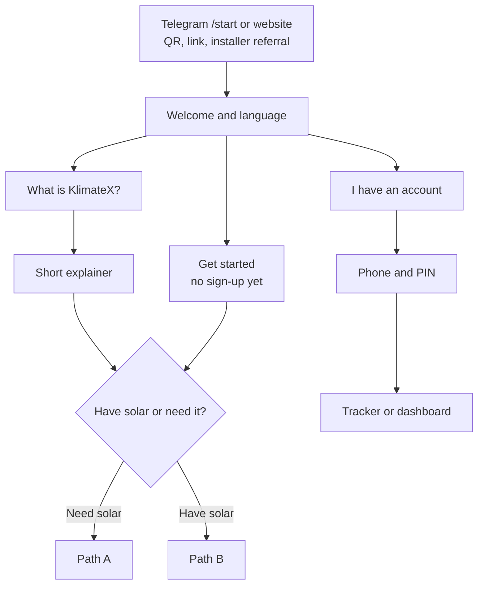
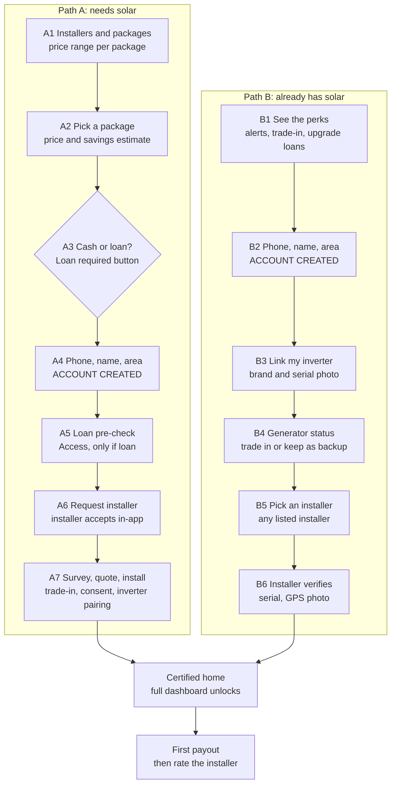

# Family onboarding flow (locked)

Locked 13 November 2026, built the same day (backend, Telegram bot and website; API in section "How it is built" below). This is the agreed flow for how a family joins KlimateX on its own, on **both the website and the Telegram bot**. Both channels follow the same steps, share one account, and keep the bot's five languages.

It replaces the installer-only start. Today a family can only sign in after an installer has registered their phone, so nothing on the platform brings families in. With this flow a family can start by itself, and installers still bring in their existing customers.

## Decisions

| Question | Decision |
|---|---|
| When do we ask for the phone number? | After the family has seen value: the price list (path A) or the perks (path B). Asking for it creates the account. |
| How does a "need solar" family see prices? | Every installer and package at once, each with a price range. No sizing step. |
| What does the family see before certification? | The step tracker plus estimated savings and carbon income, marked as estimates. Grade, payouts and certificate stay locked. |
| Who does the check visit for a home that already has solar? | Any listed installer: their own if it's on KlimateX, otherwise one they pick from the list. |

## 1. Entry and triage

## 2. The two paths

From "account created" to "certified" the family sees the tracker plus estimates.

## Step notes

**Welcome.** Language is picked automatically from Telegram, and can be changed. There are three buttons: What is KlimateX?, Get started, I have an account.

**Account created (A4, B2).**
- Telegram: the "Share my phone number" button sends the person's own number, already verified by Telegram, so no SMS code is needed.
- Website: the existing 6-digit SMS code.
- Then name and area. A PIN is set later for the website and app.

**A1 Installers and packages.** Each listed installer shows its packages (for example 3.5 kVA inverter, 5 kWh battery, 6 panels), a price range, its badge, and how its homes perform on our meters. Until real installer prices exist, these are clearly marked sample prices.

**A3 Cash or loan.** "Loan required" adds the Access pre-check after the account is created. The sandbox approves loans up to ₦1,000,000 and refers larger ones, so the demo shows the loan covering part of the price, or "referred to Access".

**A6–A7 Installer side.** The installer sees the request in their dashboard and moves it through: accept → survey booked → quote → (loan approved) → installed. At install they record the generator trade-in, the recycler certificate, consent and the inverter serial. That creates the home.

**B1 Perks for homes that already have solar.**
- Alerts when output drops or the inverter goes offline.
- A trade-in for the generator they kept.
- A grade and certificate.
- Upgrade loans priced on their own data.
- Carbon payouts from the day they join, never backdated, and only if the verifier confirms the home qualifies.

**B6 Check visit.** The installer confirms the inverter serial, takes a GPS-tagged photo, and records the generator status. This stops anyone linking an inverter that isn't theirs.

**Certified.** The full dashboard unlocks: grade, payouts, certificate, assistant. Payouts follow audits as before.

**End of the handshake.** The first payout lands, the family is told on Telegram, and they rate the installer.

## Tracker states

- Path A: Requested → Accepted → Survey booked → Quote → Loan approved (if loan) → Installed → Certified
- Path B: Linked → Visit booked → Verified → Certified

## How it is built

| Part | Where |
|---|---|
| Installers, packages, price ranges, estimates | `backend-php/src/Services/Onboarding/Catalog.php` (three sample installers are added beside the demo's Arewa; prices are marked as samples) |
| The family's journey, installer actions, certification | `backend-php/src/Services/Onboarding/OnboardingService.php`, table `onboardings` (migration M010) |
| Telegram | `backend-php/src/Services/Telegram/BotOnboarding.php`, wired into `TelegramService`. Buttons carry `o:` data; account creation uses Telegram's own contact share |
| Tests | `backend-php/tests/Integration/OnboardingTest.php` (website path A and B, Telegram sign-up and step notices) |

API:

| Call | Who | What |
|---|---|---|
| `GET /api/onboarding/installers` | public | Installers, packages, price ranges, estimates, answer options |
| `POST /api/onboarding/phone` | public | `next: signin` for a number with a home, otherwise sends a code |
| `POST /api/auth/phone/verify` | public | Code → setup token (existing) |
| `POST /api/onboarding/account` | public | Setup token + PIN + name + area + path (+ package, payment) → signed-in session |
| `GET /api/onboarding/mine` | household | Tracker: steps, next move and whose it is, estimate |
| `POST /api/onboarding/mine/answers` | household | `income_band`, `inverter_brand`, `inverter_serial`, `generator` |
| `POST /api/onboarding/mine/submit` | household | Send the request (path B names the installer) |
| `POST /api/onboarding/mine/accept-quote` | household | Accept; with a loan, Access is asked now (sandbox caps at ₦1,000,000) |
| `POST /api/onboarding/mine/profile` | household | Change name or area, any time |
| `POST /api/onboarding/mine/change` | household | A change of heart: package or cash/loan (path A), installer, inverter or generator (path B). Allowed until the quote is accepted; after the installer has acted it goes out as a fresh request and any quote is dropped. Also restarts a cancelled sign-up |
| `POST /api/onboarding/mine/cancel` | household | Cancel the request; the account stays |
| `POST /api/assistant/ask` | household | The KlimateX AI also answers families still signing up, from their progress, the packages, the loan pre-check and how KlimateX works (read-only tools in `Services/Ai/OnboardingTools.php`) |
| `GET /api/onboarding/requests` | installer, admin | Requests to act on |
| `POST /api/onboarding/requests/{id}/{accept\|survey\|quote\|complete\|verify}` | installer, admin | Move a request on; `complete`/`verify` certify the home |

Certification creates the site, inverter and generator (scrapped if traded in), opens the family's wallet, writes `home_certified` to the ledger, and starts a week of simulated readings. The grade and certificate follow the first audit period.

## Out of scope for the first build

- Real installer accreditation.
- Live inverter-cloud linking (the demo uses simulated readings).
- WhatsApp.
- The mobile app screens, which follow after the website and bot.
